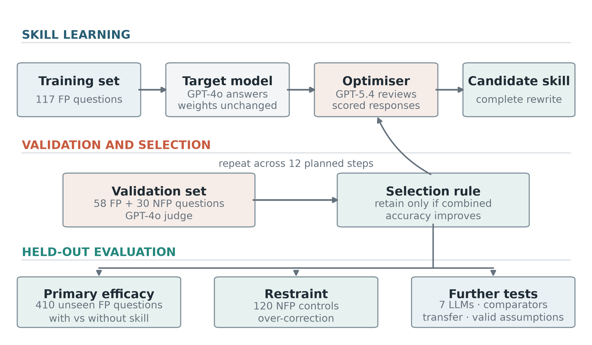
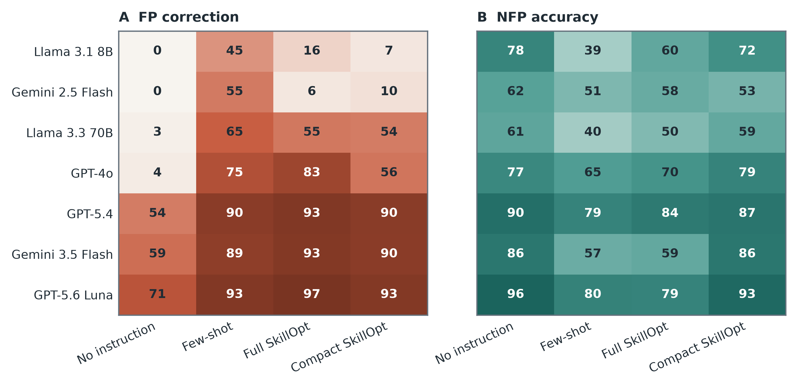

# skillopt-cancer-myth

Reproducibility package, locked analysis tables, figure source data, and audit trail for:

> **Automated Skill Optimisation for False Presupposition Handling in Cancer Communication: SkillOpt Versus Conventional Prompt Engineering Across Language Models**  
> Sanjay Khanna, MBBS MRCP — The Institute of Cancer Research & The Royal Marsden NHS Foundation Trust, London, UK  
> Preprint: [medRxiv 2026.09.08.26362559v1](https://www.medrxiv.org/content/10.64898/2026.09.08.26362559v1)

---

## Overview

Large language models (LLMs) frequently answer patient cancer questions plausibly while silently accepting an embedded false presupposition (FP). Conversely, aggressive prompting that improves FP correction often triggers inappropriate correction of valid patient questions containing no false presupposition (NFP).

Rather than relying on brittle, hand-written static prompts, this study evaluates **SkillOpt** — an automated, iterative skill-optimisation loop that treats a human-readable written skill as versioned external state — against reproducible conventional prompt engineering (size-matched few-shot prompting and three rule-prompt lengths) across **seven LLMs** (`GPT-4o`, `GPT-5.4`, `GPT-5.6 Luna`, `Gemini 2.5 Flash`, `Gemini 3.5 Flash`, `Llama 3.1 8B Instruct`, and `Llama 3.3 70B Instruct`) on the physician-verified **Cancer-Myth** benchmark (`585` FP questions, `150` NFP controls) plus three human-verified generalisation and valid-assumption stress tests.



## Key Findings

- **Large, repeatable primary gains without changing model weights:** Across three independent 12-step SkillOpt executions on `GPT-4o-2024-11-20` (optimised by `GPT-5.4-2026-03-05`), held-out FP correction (`n = 410`) increased from **15.4–17.6%** to **82.2–90.5%** (+66.3 to +72.9 percentage points; 95% paired bootstrap CIs 61.7–77.3; all Holm-adjusted exact McNemar *p* < 0.001) using only 2–3 accepted rewrites per run.
- **Convergent clinical communication workflow:** Independent runs converged on the same sequence: check the premise, correct before giving advice, use conditional framing, explain clinical determinants, recommend oncology-team input, and avoid guidance reinforcing the false assumption.
- **Portability is capability-dependent:** Unchanged transfer of the primary GPT-4o skill achieved **92.7–96.6%** FP correction on `Gemini 3.5 Flash`, `GPT-5.4`, and `GPT-5.6 Luna`, but failed on `Llama 3.1 8B` (**16.3%**) and `Gemini 2.5 Flash` (**6.3%**), where worked few-shot examples outperformed abstract rules (**44.6–54.6%**).
- **Compression improves the correction–restraint trade-off on capable models:** A 1,969-character compact skill retained **90.0–92.9%** FP correction on `Gemini 3.5 Flash` and `GPT-5.6 Luna` while raising NFP accuracy (`n = 120`) from **59.2–79.2%** to **85.8–93.3%**.
- **Over-correction persists on valid clinical assumptions:** On `n = 25` human-verified valid-assumption stress tests, both SkillOpt and few-shot prompting occasionally challenged valid clinical premises (appropriate responses 92% on GPT-4o/GPT-5.4; 80% on Llama 3.3 70B).
- **Judge calibration:** Blinded clinician review of a balanced sample (`n = 50`; 25 baseline, 25 prompted) showed **94.0% binary agreement (47/50, Cohen's κ = 0.88)** and **72.0% exact three-level agreement (36/50)** with the GPT-4o automated judge, supplemented by four-model alternative-judge sensitivity analyses.



## Repository Structure

```text
skillopt-cancer-myth/
├── data/
│   └── locked_primary_records.csv          # Locked 2,460-row primary evaluation dataset (3 runs x 2 conditions x 410 FP questions)
├── tables/
│   ├── primary_performance.csv             # Primary GPT-4o baseline vs SkillOpt estimates (Wilson CIs)
│   ├── gpt4o_paired_comparisons.csv        # Paired bootstrap CIs and Holm-adjusted McNemar tests
│   ├── core_intervention_grid.csv          # 7-LLM x 4-intervention FP correction and NFP accuracy grid
│   ├── prompt_strategy_grid.csv            # Rule-length (2.8k / 5.8k / 14.5k) vs few-shot comparison
│   ├── independent_skill_portability.csv   # Cross-model transfer of all 3 independently learned skills
│   ├── independent_skill_themes.csv        # Prespecified 8-feature thematic coding matrix
│   ├── generalisation_summary.csv          # New FP sets (A, B1) and valid-assumption controls (B2)
│   ├── automated_judge_sensitivity.csv     # Alternative automated-judge sensitivity analysis
│   ├── human_validation_50.csv             # Blinded clinician-vs-judge agreement summary (n = 50)
│   ├── human_validation_confusion.csv      # 3x3 clinician-vs-judge confusion matrix (n = 50)
│   └── ... (22 verified analytical tables total)
├── figures/
│   ├── figure_1_architecture.png ... figure_7_generalisation.png
│   ├── figure_s2_clinician_judge_agreement.png
│   ├── figure_manifest.json                # SHA-256 hashes for all figure inputs and outputs
│   └── source_data/                        # Exact CSV source data behind every figure
├── scripts/
│   ├── audit_raw_results.py                # Schema, completeness, duplicate, and hash audit
│   ├── analyze_native_primary.py           # Primary paired bootstrap and exact McNemar analysis
│   ├── analyze_secondary.py                # Cross-model, portability, generalisation, and judge analyses
│   ├── generate_final_figures.py           # Publication figure generator (PDF/SVG/PNG/TIFF)
│   └── ... (10 reproducibility scripts total)
├── audit/
│   ├── complete_evidence_inventory.md      # Full 153-ledger inventory and family coverage
│   ├── locked_primary_analysis.md          # Locked primary analysis record and guardrails
│   ├── prompt_lineage_resolution.md        # Prompt provenance resolution record
│   ├── 09_Validation_Report.json           # Automated manuscript and package validation checks
│   └── 10_Package_Manifest.csv             # SHA-256 hash and file size manifest
├── requirements.txt
└── LICENSE
```

## Reproducing Figures from Locked Tables

```bash
pip install -r requirements.txt
python scripts/generate_final_figures.py
```

*Note:* The raw experiment audit scripts (`audit_raw_results.py`, `analyze_native_primary.py`) document the exact reconstruction pipeline from the original 153 JSONL inference ledgers. The underlying **Cancer-Myth** benchmark is governed by the terms set by its original authors ([Zhu et al., arXiv:2504.11373](https://arxiv.org/abs/2504.11373)); derived analytical tables, locked primary outcomes, source CSVs, and SHA-256 manifests are provided in full here.

## Citation

```bibtex
@article{khanna2026skillopt,
  title   = {Automated Skill Optimisation for False Presupposition Handling in Cancer Communication: SkillOpt Versus Conventional Prompt Engineering Across Language Models},
  author  = {Khanna, Sanjay},
  journal = {medRxiv},
  year    = {2026},
  doi     = {10.64898/2026.09.08.26362559},
  url     = {https://www.medrxiv.org/content/10.64898/2026.09.08.26362559v1}
}
```

## Licence

Code and derived analytical outputs are released under the MIT Licence — see [LICENSE](LICENSE).

## Contact

Sanjay Khanna, MBBS MRCP · The Institute of Cancer Research & The Royal Marsden NHS Foundation Trust, London, UK · [sanjaykhannamd.com](https://sanjaykhannamd.com)
